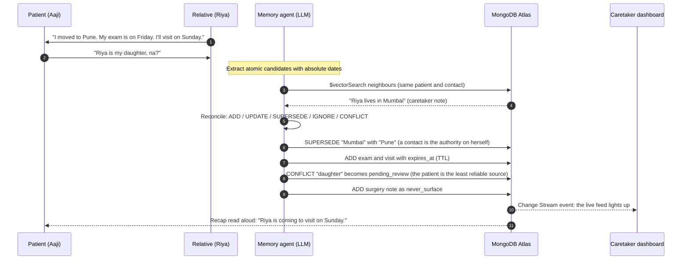
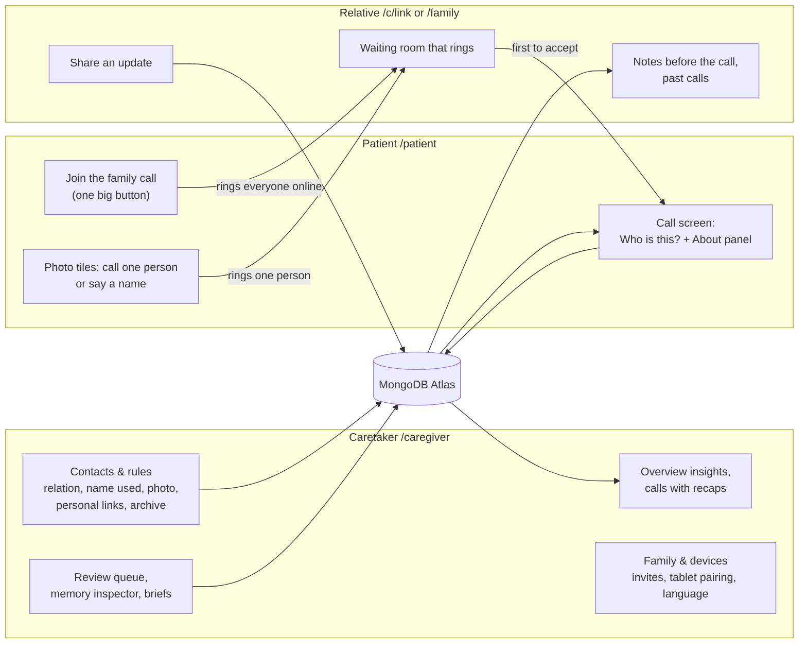
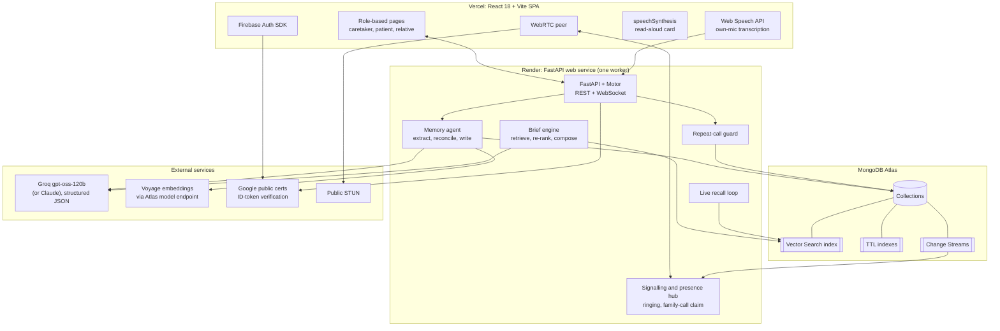

<div align="center">

# Pehchaan

### An agentic-memory video-calling companion for people living with Alzheimer's disease

**MongoDB Student Hackathon · SVNIT · Track 1: Agentic Memory**


*Pehchaan* (पहचान) means **recognition**. The product tells the patient who is on the screen, and it remembers what the two of them said last time.

**Live:** [pehchaan-uncharted.vercel.app](https://pehchaan-uncharted.vercel.app) · API [pehchaan-api-m53t.onrender.com/api/health](https://pehchaan-api-m53t.onrender.com/api/health)

</div>

---

## Table of contents

| # | Section | What it covers |
|:-:|---|---|
| 1 | [Agentic Memory](#1-agentic-memory-the-core-of-the-system) | The thesis, memory properties mapped to MongoDB, one call end to end |
| 2 | [MongoDB capabilities](#2-mongodb-is-the-system-of-record-the-vector-store-the-event-bus-and-the-analytics-engine) | Vector Search, TTL, Change Streams, aggregation, indexes, [collections](#collections) |
| 3 | [Product and roles](#3-product-three-roles-one-shared-memory) | Caretaker, patient and relative, the [family call](#the-family-call) |
| 4 | [The call screen](#4-the-call-screen-recognition-on-both-sides) | "Who is this?" card, About panel, live recall, the relative's notes |
| 5 | [System architecture](#5-system-architecture) | Diagram, [write path](#write-path-appagentpipelinepy), [read path](#read-path-appagentbriefpy), [guard](#memory-changes-actions-appagentguardpy), [real-time](#real-time-communication), [auth](#authentication-and-authorisation) |
| 6 | [Technology stack](#6-technology-stack) | Every layer, plus [graceful degradation](#graceful-degradation) |
| 7 | [Use cases](#7-use-cases) | Ten concrete scenarios |
| 8 | [Repository layout](#8-repository-layout) | Annotated file tree |
| 9 | [Getting started](#9-getting-started) | Setup, [environment](#environment), [verify](#verify), [deploy](#deploy-render--vercel) |
| 10 | [Five-minute demonstration](#10-five-minute-demonstration) | Step-by-step demo script |
| 11 | [Ethics, privacy and safety](#11-ethics-privacy-and-safety) | Consent, minimisation, least privilege |
| 12 | [Not in this build](#12-not-in-this-build) | Work that lives on other branches |

---

## 1. Agentic Memory: the core of the system

Pehchaan is built on one thesis: **for a patient with Alzheimer's disease, an assistant is only useful if its memory is
persistent, structured, governed and self-correcting.** A flat chat history or a vector dump of raw transcripts cannot
satisfy those four properties. Pehchaan therefore treats memory as a **first-class, autonomously curated MongoDB
data model** rather than a log.

After every call an **LLM agent** (Groq `gpt-oss-120b` in the deployed app; Claude is also supported) reads the speaker-tagged transcript and decides, *per fact*, whether to
**ADD**, **UPDATE**, **SUPERSEDE**, **IGNORE** or flag a **CONFLICT**. That decision is then constrained by a
deterministic, code-enforced **trust-and-provenance policy**. The next call begins with a brief that is *retrieved,
re-ranked and policy-filtered* from that memory. The memory also **changes actions, not only text**: it can refuse to
place a call.

| Property of the memory | Mechanism | MongoDB primitive |
|---|---|---|
| **Persistent** | Atomic, dated facts with provenance (`source.call_id`, `source.quote`, `speaker`) | Document model, `memories` collection |
| **Semantically retrievable** | 1024-dimensional embeddings, pre-filtered by patient, contact, status and visibility | **Atlas Vector Search** (`$vectorSearch`, `memory_vec`) |
| **Self-correcting** | Supersede chains (`supersedes` / `superseded_by`), versioning, conflict links | Document references and atomic updates |
| **Governed** | Trust hierarchy, `pending_review` queue, `visibility` classes, hard-delete "forget" | Compound indexes, cascade deletes |
| **Self-expiring** | Events and plans expire automatically after the event date | **TTL indexes** (`expires_at`, `expireAfterSeconds: 0`) |
| **Observable in real time** | Caretaker edits reach the patient's screen mid-call | **Change Streams** (pre-images used when the cluster has them enabled) |
| **Auditable** | Append-only log of ids and actions (never content), so forgetting really forgets | `memory_events` collection |
| **Analysable** | Calls per day and hour, recurring confusions, memory bank composition | **Aggregation framework** (`$facet`, `$lookup`, `$dateTrunc`) |

### What a single call does to the memory



The first call shows only the caretaker's basics. After the agent runs, the *same* relative's next brief says *lives in
Pune* and suggests *"How did your physics exam go?"*. That loop is what the system exists to demonstrate.

---

## 2. MongoDB is the system of record, the vector store, the event bus and the analytics engine

Every non-trivial requirement of the product maps to a native MongoDB capability. There is no second database, no
separate vector store and no message broker.

| MongoDB capability | Where it is used | Why it matters here |
|---|---|---|
| **Atlas Vector Search** (`$vectorSearch`) | `memory_vec` index over `memories.embedding` (1024-d cosine). Filter fields: `owner_id`, `contact_id`, `type`, `status`, `visibility`, `embedding_model`, `created_at`. Used by the write path (neighbours of each candidate fact) and the read path (brief retrieval). | **Pre-filtered ANN retrieval.** A patient's search can never cross into another patient's data, and `superseded`, `caregiver_only` and `never_surface` rows are excluded *inside* the index query rather than after the fact. |
| **Model-tagged vectors** | Every vector stores `embedding_model`; searches compare only like with like; a background job re-embeds locally embedded rows with Voyage. | Prevents mixing vector spaces when the embedding provider is rate-limited or swapped. |
| **TTL indexes** | `memories.expires_at` (event date plus N days), `transcript_chunks.created_at` (30 d), `invites` (7 d), `pairing_codes` (15 min), `auth_events` (90 d), `embedding_cache` (30 d). | Data minimisation is enforced by the database itself. Transcripts, one-time codes and stale events disappear without application cron jobs. |
| **Change Streams** | Watchers on `memories` and `calls`, relayed over WebSocket. `fullDocumentBeforeChange` is requested when pre-images are enabled on the collection. | A caretaker's edit appears on the patient's "Who is this?" card **mid-call**, and a processed call refreshes the patient's home screen. With pre-images on, TTL deletions also show *what* expired. |
| **Aggregation framework** | `app/stats.py`. One `$facet` over `calls`: per-day and per-hour counts (`$dateTrunc` / `$hour` in IST), who talks to whom (`$lookup` into `contacts`), period-over-period totals. One `$facet` over `memories`: bank by type, upcoming events, **recurring confusions** (the same mistaken belief grouped and counted). Activity from `memory_events` joined to `memories`. | Clinically relevant insight, such as sundowning clusters of blocked calls or one mistaken belief recurring three times, is computed server-side inside the database. |
| **Compound, sparse and unique indexes** | `memories (owner_id, contact_id, status, type)`, `calls (patient_id, contact_id, started_at)`, `contacts.link_token` (unique, sparse), `contacts.user_id`, `users.firebase_uid` (unique, sparse), `memberships (patient_id, user_id)` (unique), `devices.firebase_uid` (unique), `pairing_codes.code` and `invites.code` (unique). | Per-patient scoping, relative links, relative accounts, paired tablets and role resolution are all index-backed. |
| **Flexible document model** | `calls.agent.actions[]`, `calls.overlay` (how often "Who is this?" was shown or asked), `calls.recall_cards[]`, `briefs.items[]` with per-candidate score breakdowns, `memories.rule` for caretaker constraints. | Nested, evolving structures live with their parent. No joins on the hot path. |
| **Atomic updates and unique constraints** | The family call is claimed with one conditional `update_one` (`status: ringing, contact_id: null`); invite and pairing codes are unique. | When several relatives press Accept at once, exactly one gets the call, without distributed locks. |
| **Atlas Local and Atlas** | `docker-compose.yml` (`mongodb-atlas-local`) for development, an Atlas cluster in production. | An identical feature set from laptop to deployment. |

### Collections

| Collection | Purpose |
|---|---|
| `memories` | The agentic memory: typed, versioned, vector-indexed, TTL-governed. |
| `memory_events` | Append-only audit trail of agent decisions (ids and actions only). |
| `contacts` | Relatives and friends: name, the name the patient uses for them, relation, photo, voice nicknames, personal link token, linked account, active / pending / archived status. |
| `calls` | Every call or attempt: participant (or an open family call waiting to be claimed), join token, guard result, transcript summary, recap, overlay and recall-card logs. |
| `contact_updates` | Written updates a relative shares from their link or account ("I got engaged"), fed through the same memory pipeline. |
| `transcript_chunks` | Speaker-tagged transcript, **auto-deleted after 30 days**. |
| `briefs` | Every generated pre-call brief with each candidate's score breakdown (inspectable). |
| `users`, `memberships`, `devices` | Identity linkage: owner / family / viewer roles per patient, paired tablets. |
| `pairing_codes`, `invites`, `auth_events` | One-time codes and the access log, all TTL-governed. |
| `embedding_cache` | Voyage results keyed by text hash, so identical text is never embedded twice. |

---

## 3. Product: three roles, one shared memory



| Role | Lands on | Capabilities |
|---|---|---|
| **Caretaker** | `/caregiver` | Adds and edits family and friends (relation, the name the patient uses for them, photo, voice nicknames), copies each person's **personal link**, archives someone who has died with a note for relatives, approves new people, sets **rules** (quiet hours, daily caps, minimum gaps), works the **review queue**, inspects and corrects memories, previews briefs, reads every call with its recap, invites other family members as owner, family or viewer, pairs the patient's tablet, and sets the patient's language. |
| **Patient** | `/patient` | One large **Join the family call** button, photo tiles with "talked yesterday" and the last recap line, voice "Who do you want to talk to?", and a Help button that calls the primary contact. Signs in with their own account or a tablet paired once with a 6-digit code, and never types a password. The interface speaks English, Hindi, Marathi or Gujarati. |
| **Relative** | `/c/<token>` or `/family` | A personal link that needs no account, or their own account at `/family` that covers every patient they are linked to. A waiting room that **rings** when the patient calls, a **Share an update** box ("My exam is on Friday") that goes through the memory pipeline, notes before the call (talking points, what the patient's memory has about them, the family's guidance about people who have died) and past calls with recaps. |

### The family call

The patient does not have to choose anyone. **Join the family call** opens a call immediately and rings every relative
whose page is open and whom the caretaker's rules allow. The **first relative to accept** gets the call: the claim is a
single conditional `update_one`, so two simultaneous accepts cannot both win, and every other phone stops ringing. A
relative who declines only stops their own ring. If nobody is online, the meeting stays open (15 minutes by default) and
anyone who opens their page later finds it waiting. The patient never sees "nobody is free". Calling one specific person
from a tile works the same way with one ringer.

---

## 4. The call screen: recognition on both sides

Identity comes from **who answered**: the relative's personal link or account says who they are, so the card never
guesses a name.

**On the patient's screen**

* **"Who is this?" card.** Name as the patient says it ("Lata tai"), the relation from the patient's side ("your
  granddaughter"), the photo and at most one memory line. It opens when the video connects, is **read aloud**, and then
  shrinks to a small name tag at the bottom edge so it never covers a face. A large **Who is this?** button, or saying
  "who is this?", opens it again. Asking twice in one call slightly raises the importance of the relationship memory, so
  later cards lead with clearer identity details.
* **About panel.** A calm side panel, never read aloud: who this is, **what you talked about** (the last three call
  recaps), **coming up** (plans and events) and **always true** (lasting facts, relationship first). It only shows
  active, patient-visible memories, never talking points, rules or private notes.
* **Live recall cards.** Every ~10 s the relative's last ~30 s of speech is embedded and matched with `$vectorSearch`
  (this patient, this contact, active and patient-visible only). A strong match shows one small card for ~10 s, at most
  one a minute and never the same memory twice. Embeddings only, no LLM call.
* **Who else is here.** The relative can add the people sitting with them, and the card names them too.

**On the relative's screen ("For you")**

* What the patient's card currently says, so the relative knows what has been shown.
* **You could ask** (talking points from the brief), **if the patient asks** (the family's note about someone who has
  died, for example "don't break the news again, ask her to tell you about him"), and what the patient's memory holds
  about them with 👍 / 👎 feedback that re-weights the memory for future briefs.
* **Go off the record** at any time: nothing said is transcribed or remembered until they switch back.

When the call ends, the recap is read to the patient and appears on their home screen tile, in the relative's past
calls, and on the caretaker's dashboard.

---

## 5. System architecture



### Write path: `app/agent/pipeline.py`

1. **Extract.** The LLM reads the speaker-tagged transcript (or a relative's written update) and returns a summary, a
   patient-facing recap in the patient's language and *atomic* candidate memories with absolute dates.
2. **Neighbour retrieval.** Each candidate is embedded and searched with `$vectorSearch` over the same patient and
   contact. Same-type facts and relationships are always included.
3. **Reconcile.** The LLM chooses `ADD / UPDATE / SUPERSEDE / IGNORE / CONFLICT` for the whole batch in one call.
4. **Trust guard, enforced in code.** Trust: caretaker `1.0`, contact about themselves `0.85`, contact about others
   `0.7`, patient `0.4`. *In this domain the user is the least reliable narrator.* Trust is **subject-aware**: Riya is
   the authority on her own life, so "I moved to Pune" supersedes the caretaker's older "lives in Mumbai". Patient claims
   never overwrite anything, and only the caretaker may alter relationships. Anything blocked becomes a
   `pending_review` CONFLICT.
5. **Lifecycle.** Events and plans receive `expires_at`. Sensitive items become `never_surface`. Patient claims route to
   `caregiver_only` and `pending_review`.
6. **Audit.** Every action is appended to `memory_events` (**ids and actions only**, so a hard "forget" is a true erase).

### Read path: `app/agent/brief.py`

Candidates come from deterministic core facts, **open loops** (events or plans within ±3 days), `$vectorSearch`
(filtered by owner, contact, `status: active` and `visibility: patient`), a "recent topic" vector query filtered by
`type` and `created_at`, and the last two call summaries. They are then re-ranked:

```
final   = 0.5·similarity + 0.2·recency + 0.15·importance + 0.15·trust      (+0.3 open-loop boost)
recency = exp(−days / 14)
```

The relationship memory is always shown. `never_surface` memories are passed to the LLM only as **negative guardrails**
and are never displayed. If the LLM takes longer than 10 s, a template brief is used, so the patient never waits. Every
brief persists each candidate's score breakdown, so the **Memory Inspector** can explain *why* any item appeared.

### Memory changes actions: `app/agent/guard.py`

Caretaker-authored **constraint memories** carry a structured `rule` (`quiet_hours`, `max_calls_per_day`,
`min_gap_minutes`). Quiet hours and a daily cap are **hard blocks**. A minimum gap is a **soft reminder** with a
*Call anyway* button ("You spoke to Riya at 11:05. Riya will visit Aaji on Sunday."). The same rules decide which
relatives a family call rings. Calling an archived person is refused gently. Blocked attempts are stored, which is what
surfaces sundowning patterns in the insights.

### Real-time communication

* **WebRTC** 1-to-1 media with public STUN servers, signalled over a WebSocket whose **authentication travels in the
  first frame, never in the URL**.
* A **presence hub** keeps each relative's open pages (link or account) so the patient's call can ring them, and tells
  the others to stop ringing once one accepts.
* Each browser transcribes **only its own microphone**. Chunks are tagged by speaker and posted to the call. Text the
  app reads aloud is dropped, so the card never becomes a "memory".

### Authentication and authorisation

**Firebase proves *who*. MongoDB decides *what*.** The backend verifies Firebase ID tokens using Google's public
certificates (only the project id is required, with no service-account key). A principal is a **paired tablet**
(anonymous Firebase user linked in `devices`), the **patient's own account**, or a **caretaker / relative account**
whose care-circle roles come from `memberships` and whose linked relatives come from `contacts.user_id`. Every route
re-checks the caller's role for that specific patient. Personal links and join links carry unguessable tokens.

---

## 6. Technology stack

| Layer | Technology | Role in Pehchaan |
|---|---|---|
| **Database** | **MongoDB Atlas** (Vector Search, Change Streams, TTL, Aggregation), `mongodb-atlas-local` | Memory store, vector index, event bus, analytics, identity linkage |
| **Backend** | Python 3.12, **FastAPI**, Uvicorn, **Motor** (async driver), Pydantic v2 | REST and WebSocket API, async I/O, validation |
| **LLM** | **Groq** `openai/gpt-oss-120b` (deployed) or **Anthropic Claude**, strict JSON-schema output | Fact extraction, reconciliation, brief and recap writing |
| **Embeddings** | **Voyage** `voyage-3.5` (1024-d) via the MongoDB model endpoint, local hashed fallback | Semantic retrieval and live recall, cached in `embedding_cache` |
| **Frontend** | **React 18**, React Router 6, **Vite 5** | Role-based SPA, four patient languages |
| **Video** | **WebRTC**, WebSocket signalling, public STUN | Peer-to-peer 1:1 video |
| **Speech** | Web Speech API (STT), `speechSynthesis` (TTS) | Live transcription, read-aloud card |
| **Auth** | **Firebase Authentication** (Google, email/password, anonymous for tablets) | Identity. Authorisation lives in MongoDB. |
| **Deployment** | **Render** (backend web service) + **Vercel** (frontend) | API and WebSockets on Render, static SPA on Vercel |
| **Tooling** | Headless smoke test, Docker Compose | Reproducible verification |

The agent is plain Python: no agent framework (LangChain and LangGraph are not used).

### Graceful degradation

Every external dependency has a fallback, and the dashboard shows which mode is active.

| Piece | Normal | Fallback |
|---|---|---|
| Memory agent and brief writer | Groq or Claude, structured JSON | Rule-based extractor and template brief (`agent/offline.py`) |
| Embeddings | Voyage `voyage-3.5`, 1024-d | Local hashed embedding of the same width, re-embedded later |
| Retrieval | Atlas `$vectorSearch` with pre-filters | Exact in-app cosine scan |
| Live updates | MongoDB Change Streams | Events emitted from application code |
| Speech-to-text | Web Speech API | "Type instead" box on both sides |
| Authentication | Firebase | **Dev auth mode** (local, no password) when `FIREBASE_PROJECT_ID` is blank |

---

## 7. Use cases

| # | Scenario | What happens |
|---|---|---|
| 1 | **Disorientation on a call.** Aaji doesn't recognise the face. | The card names the person the way she says it, the relation from her side and one recent memory, and reads it aloud. Asking "who is this?" again brings it back. |
| 2 | **A relative changes their life.** Riya moves from Mumbai to Pune. | The agent supersedes the old fact. The next brief is correct and the stale fact is retained only as history. |
| 3 | **The patient misremembers.** Aaji calls Riya her daughter. | The claim is trust-weighted at `0.4`, never overwrites the caretaker's record, and is queued as a conflict. Repeated confusions are counted on the dashboard. |
| 4 | **A secret must stay a secret.** "Don't tell Aaji about Papa's surgery." | Stored as `never_surface`. Visible to the caretaker, passed to the LLM as a guardrail, never shown to the patient. |
| 5 | **Repeated calling and sundowning.** Aaji calls the same person eleven times in an evening. | The guard enforces caretaker rules, reassures with the last recap, and logs each blocked attempt for insight. |
| 6 | **Someone has died.** Aaji asks for her late husband. | The caretaker archives him with a note. His tile disappears, a call to him is refused gently, and the relative on the call sees the family's guidance on how to answer. |
| 7 | **An upcoming event.** The exam on Friday. | The open-loop boost makes the next brief say "ask about the exam", and the TTL index removes the event afterwards. |
| 8 | **News between calls.** Riya types "I got engaged" on her link. | The update runs through the same memory pipeline and the next card can mention it. |
| 9 | **Privacy.** | Off-the-record mode, a consent note, 30-day transcript TTL and hard-delete forgetting. Audio and video are never stored. |
| 10 | **Whole-family call.** | The patient presses **Join the family call**. Every relative with their page open rings, the first to accept takes the call, and the meeting waits if nobody is free yet. |

---

## 8. Repository layout

```
.
├── docker-compose.yml                            local MongoDB with Atlas features
├── setup.md                                      detailed local setup, two-laptop testing, deployment
├── UIUX.md                                       the UI polish pass and design tokens
├── docs/DESIGN.md                                product and design specification
├── specs/                                        build specs and the previous README
├── backend/
│   ├── requirements.txt · .env.example
│   ├── scripts/smoke.py                          headless end-to-end test of the memory loop and calls
│   └── app/
│       ├── main.py             REST + WebSocket API: calls, briefs, memories, contacts, insights
│       ├── auth.py             Firebase ID-token verification, principal resolution, authorisation
│       ├── routes_auth.py      session, care circles, invites, device pairing, access log
│       ├── routes_contact.py   relatives: personal links, accounts, presence, ringing, updates
│       ├── callcard.py         what each side sees: "Who is this?" card, About panel, relative notes
│       ├── recall.py           live recall cards during a call
│       ├── lang.py             patient languages and "who is this?" phrases
│       ├── db.py               collections; TTL, compound, sparse and vector indexes
│       ├── memory_store.py     memory documents, lifecycle, audit log, vector search
│       ├── embeddings.py       Voyage / local embeddings with cache and model tagging
│       ├── llm.py              Groq / Claude structured-output wrapper with fallbacks
│       ├── realtime.py         signalling hub, presence, transcript fan-out, change-stream watchers
│       ├── stats.py            aggregation pipelines for caretaker insights
│       ├── seed.py             six weeks of demo history written through the real memory code
│       └── agent/              pipeline (write) · brief (read) · guard · prompts · offline
└── frontend/
    ├── vercel.json             sends every route to the SPA
    └── src/
        ├── lib/                api, identity, auth, rtc, speech, tts, i18n
        ├── components/         CallCards (Who is this?, About, recall, relative panel), Relative, charts
        └── pages/              PatientGate · PatientHome · CallPage · JoinPage · ContactLink · FamilyHome · Login
                                caregiver/ Overview · ReviewQueue · Inspector · Briefs · Calls · Contacts · Family · Onboarding
```

---

## 9. Getting started

**Prerequisites:** Python 3.11+, Node 18+, Chrome, and either Docker or a MongoDB Atlas cluster.

```bash
docker compose up -d                      # MongoDB with Vector Search, Change Streams, TTL
cp backend/.env.example backend/.env      # every key is optional (see Graceful degradation)
cd backend && python -m venv .venv && .venv/bin/pip install -r requirements.txt   # Windows: .venv/Scripts/pip
.venv/bin/python -m uvicorn app.main:app --reload --port 8000
```

```bash
cd frontend && npm install && npm run dev        # http://localhost:5173 (npm run dev:https for a second laptop)
```

Sign in at `/login`, choose **Explore the demo family**, and use **Reset demo** to regenerate the seeded history.
A detailed walkthrough, including testing with two laptops, is in [setup.md](setup.md).

### Environment

**Backend** (`backend/.env`, or the Render dashboard)

| Variable | Purpose |
|---|---|
| `MONGODB_URI`, `MONGODB_DB` | Atlas or local connection |
| `GROQ_API_KEY` | Memory agent and brief writer (used first when set) |
| `ANTHROPIC_API_KEY` | Claude instead of Groq (optional) |
| `LLM_MODE` | `auto` (default), `groq`, `claude` or `offline` |
| `VOYAGE_API_KEY`, `VOYAGE_BASE_URL` | Embeddings. Use `https://ai.mongodb.com/v1` for Atlas-issued keys |
| `FIREBASE_PROJECT_ID` | Enables real Firebase token verification (blank means dev auth) |
| `PUBLIC_BASE_URL` | The frontend's address, used in relatives' links and join links |
| `TIMEZONE` | Default `Asia/Kolkata` |

**Frontend** (`frontend/.env`, or the Vercel dashboard)

| Variable | Purpose |
|---|---|
| `VITE_FIREBASE_API_KEY`, `VITE_FIREBASE_AUTH_DOMAIN`, `VITE_FIREBASE_PROJECT_ID`, `VITE_FIREBASE_APP_ID` | Firebase web config (public identifiers). Blank means dev sign-in. |
| `VITE_API_URL` | The backend's address when it runs on another host. Blank locally (Vite proxies `/api` and `/ws`). |

**Never commit `.env` files, the Atlas password or API keys.** They are git-ignored.

### Verify

```bash
cd backend && .venv/bin/python scripts/smoke.py
```

With the backend in dev auth mode, this signs in, pairs a test tablet and plays calls through the API and real
WebSockets, asserting each beat: supersede, conflict, TTL fields, `never_surface`, the repeat-call guard, the later
brief and its score breakdowns, the "Who is this?" card and About panel, personal links and ringing, written updates,
archiving, languages, relative accounts, and the family call (atomic claim, declines, an unanswered call).

### Deploy (Render + Vercel)

* **Render**, web service, root directory `backend`: build `pip install -r requirements.txt`, start
  `uvicorn app.main:app --host 0.0.0.0 --port $PORT`, health check `/api/health`, `PYTHON_VERSION=3.12.7` plus the
  backend variables above. Run exactly **one** instance, since the signalling hub is in-process.
* **Vercel**, root directory `frontend`, Vite preset, with the frontend variables above and `VITE_API_URL` set to the
  Render URL. The browser talks to Render directly because Vercel rewrites cannot carry WebSockets.
* Allow `0.0.0.0/0` in Atlas Network Access, add the Vercel domain to Firebase **Authorized domains**, and set
  `PUBLIC_BASE_URL` on Render to the Vercel URL.

---

## 10. Five-minute demonstration

1. **Setup.** The caretaker opens `/caregiver`, chooses the demo family and presses **Reset demo**, copies Riya's
   personal link from **Contacts & rules**, and opens `/patient` on the tablet. Riya opens her link on a phone and
   presses **I'm ready**.
2. **First call.** Aaji presses **Join the family call**. Riya's phone rings and she accepts. The **"Who is this?"** card
   names her and is read aloud; the **About panel** shows what they talked about last time. Riya says *"I moved to Pune.
   My physics exam is Friday. I'll visit on Sunday."* Aaji says *"Riya is my daughter, na?"* Riya adds *"Don't tell Aaji
   about Papa's surgery."*
3. **Agent runs.** The dashboard feed lights up through Change Streams. *Pune* supersedes *Mumbai*, the exam and visit
   are added with `expires_at`, *daughter* lands in the review queue, and the surgery note is `never_surface`. Aaji
   hears the recap.
4. **Guard.** Call Riya again immediately: *"You spoke to Riya at 10:15… Do you still want to call?"*
5. **Time travel.** Advance the demo clock past the exam. The next brief says *lives in Pune* and suggests *"How did
   your physics exam go?"*
6. **Inspect.** Open the memory in the Memory inspector: source quote, score bars, supersede chain, audit log.
7. **A difficult case.** Show Madhav, archived with the family's note: his tile is gone, and a relative on a call sees
   how to answer if Aaji asks for him.

---

## 11. Ethics, privacy and safety

* **Consent first.** Every relative sees a consent note before joining and can go **off the record**; nothing said then is stored.
* **Data minimisation.** Audio and video are never stored. Transcripts expire after 30 days by TTL.
* **The patient is not ground truth.** Patient statements are trust-weighted at `0.4` and can never overwrite the caretaker's record.
* **Identity is never guessed.** The card names the person who answered through their own link or account, nothing else.
* **Caretaker control.** Caretakers decide what the patient may see, new people require approval, and forgetting is a hard delete.
* **Least privilege.** Every route checks the caller's role per patient. WebSocket credentials never appear in URLs or logs. Personal links and join tokens are unguessable.

Pehchaan is a **communication aid, not a medical device**.

---

## 12. Not in this build

The `pratham` branch explores a different direction that is **not merged or deployed**: face recognition with
face-api.js, caretaker-scheduled meets with 6-character codes, a separate `/relative` home, a TURN relay and a
single-service Docker deployment. The deployed app identifies people by their personal link or account instead, and
uses the one-button family call in place of scheduled meets.

---

<div align="center">

Built for the **MongoDB Student Hackathon, SVNIT** · Track 1: **Agentic Memory**

</div>
