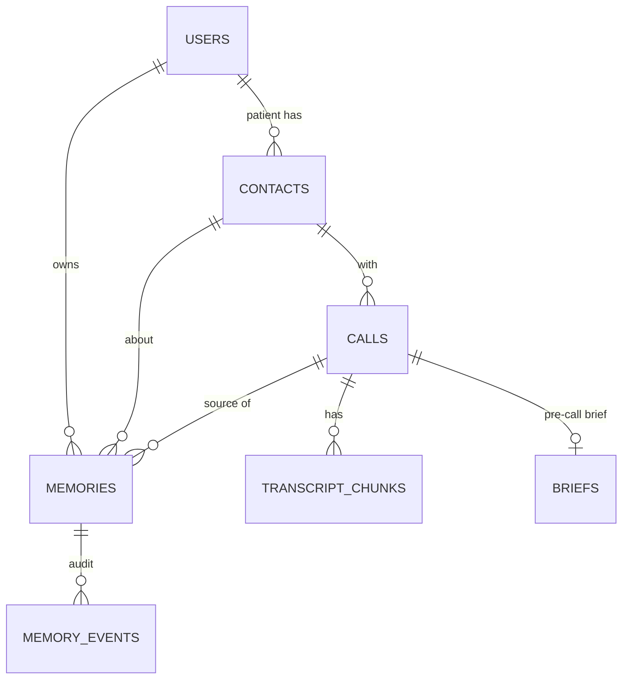
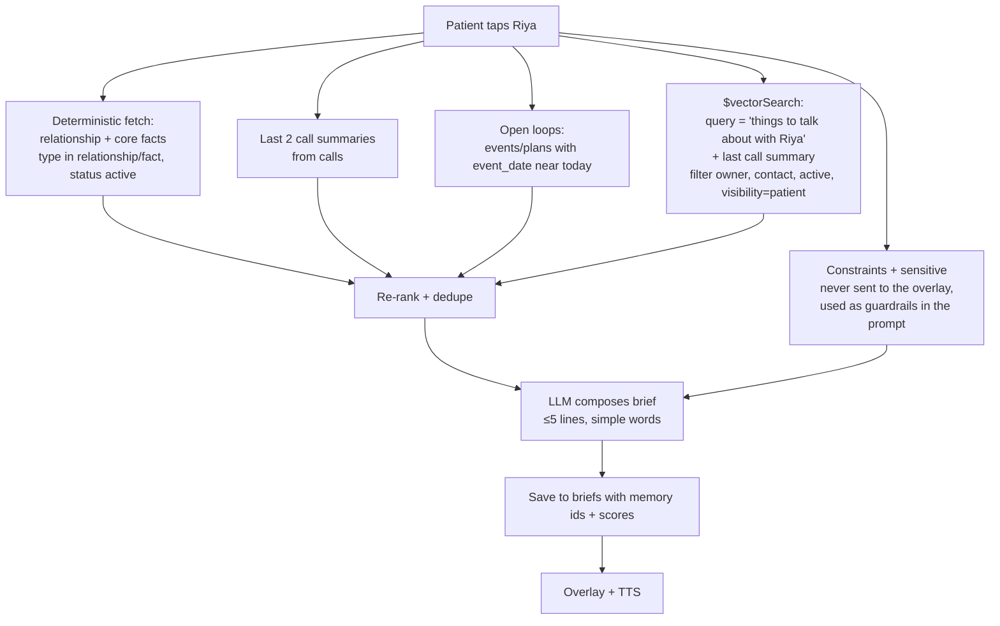
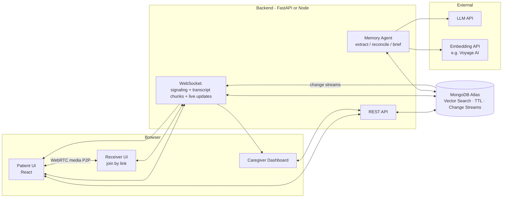

# Pehchaan — A Memory-Aware Video Calling Companion for People with Alzheimer's

> **Track 1: Agentic Memory** · MongoDB Student Hackathon, SVNIT
> Working name: *Pehchaan* ("recognition"). Alternatives: *KinLink*, *Yaad*, *RecallCall*.

---

## 0. TL;DR

A person with Alzheimer's opens a web app and sees a grid of large photos of their family. They tap a face, or say "Call Riya", and a video call starts with no help from anyone. During the call, a **"Who is this?"** overlay shows, in large text and read aloud, who the person is, how they're related, and what was talked about last time ("Riya is your granddaughter. Last Tuesday she told you about her exam. Ask how it went.").

Every call is transcribed. When it ends, an **agent** pulls out memories (facts, events, plans, preferences, sensitive topics), checks them against what's already stored, and then adds, updates, supersedes or flags them in MongoDB. **The next call to the same person starts with a different, better brief.** A caregiver dashboard lets family inspect, correct, expire and delete memories, and these changes reach the patient's screen live through change streams.

**Why this fits Track 1:** the memory changes behaviour you can see. It changes the overlay, the conversation suggestions, and whether the app warns before a repeat call. The domain also gives us natural hard cases to demo: corrections (patients misremember), expiry (plans become stale), conflicts (people move house, change jobs) and private information ("don't tell Mom about the surgery").

---

## 1. Problem & Users

### 1.1 The problem
- People with early-to-moderate Alzheimer's often **can't recall who a caller is, how they're related, or what was said recently**. This causes anxiety, embarrassment, and family members avoiding calls.
- **They repeat calls**: calling the same person 5 times an hour because they forget the earlier call.
- They depend on someone else to place calls, which costs them independence.
- Families have no shared, up-to-date picture of what the patient has been told, which leads to contradicting stories and confusion.

### 1.2 Personas
| Persona | Role in system | Needs |
|---|---|---|
| **Patient** (e.g., Aaji, 74) | Primary user: places and receives calls | Very simple UI, big faces, voice, reassurance, no jargon |
| **Contact / Receiver** (e.g., Riya, granddaughter) | Joins calls through a link | Zero install, consent for transcription, optional "what Aaji asked about recently" note |
| **Caregiver** (e.g., Rahul, son) | Admin: manages contacts and memories | Review queue, corrections, privacy controls, call history |

### 1.3 Design principles (Alzheimer-specific)
1. **Recognition over recall.** Always show a face, a name and the relation together.
2. **One action per screen.** No menus or nested navigation for the patient.
3. **Reassure, never quiz.** The overlay *tells*, it never asks "do you remember…?".
4. **Trust sources differently.** The patient's own statements are least reliable. Caregiver statements are most reliable. (This is an important design point for the agent; see §5.4.)
5. **Gentle with sensitive topics.** Some memories must never be shown to the patient (a death in the family, bad news). The caregiver decides.
6. **Consent first.** Every participant is told that the call is transcribed, and can pause it ("off the record").

---

## 2. Product Walkthrough (End-to-End Workflow)

### 2.1 High-level flow

```mermaid
flowchart LR
    A[Patient opens app] --> B[Contact grid: big photos]
    B -->|tap face / voice 'Call Riya'| C{Repeat-call guard}
    C -->|called recently| D[Gentle reminder + 'Call anyway?']
    C -->|ok| E[Pre-call brief generated from memory]
    D -->|call anyway| E
    E --> F[Video call + 'Who is this?' overlay]
    F --> G[Live transcription per speaker]
    G --> H[Call ends]
    H --> I[Memory Agent: extract → reconcile → write]
    I --> J[(MongoDB: memories, calls, transcripts)]
    J -->|change stream| K[Caregiver dashboard: review queue]
    K -->|correct / delete / mark private| J
    J --> E
```



### 2.2 Step by step

**Step 1: Home screen (patient)**
- A grid of 4–8 large photo tiles, each with name and relation ("Riya — your granddaughter").
- A big microphone button: "Who do you want to talk to?" (Web Speech API → fuzzy match on name, nickname or relation, e.g. "my son" → Rahul).
- An "Emergency" tile that always calls the primary caregiver.

**Step 2: Repeat-call guard (memory changes the action)**
- Before dialing, the system queries `calls` for this contact within the last N hours.
- If found: *"You spoke to Riya at 11:05 this morning. She said she'll call you after college at 6 PM. Do you still want to call?"* with **[Call anyway]** and **[Okay, later]**.
- The threshold is a **caregiver-set constraint memory** (e.g., "Don't let Mom call Rahul more than 3×/day; he's on night shifts and sleeps 9 AM–3 PM"). A constraint can also block calls during sleep hours and offer to "leave a voice note instead".

**Step 3: Pre-call brief (memory changes the response)**
Generated from retrieved memories (see §5.3) and cached on the call document:
```
👤 Riya — your granddaughter (Rahul's daughter)
📍 Lives in Pune (moved from Mumbai last month)
🗓 Last call: Tuesday. She told you about her Physics exam on Friday.
💬 You could ask: "How did your exam go?" · "How is Bruno (her dog)?"
```
- Large font, high contrast, **read aloud** by TTS when the overlay opens.
- At most 3–5 items. Brevity matters more than completeness for this user.

**Step 4: The call**
- 1:1 WebRTC video call inside our page, so we control the overlay.
- The receiver joins through a link (SMS/WhatsApp, or for the demo just a URL) and sees a consent banner.
- A floating **"Who is this?"** button (huge, bottom-right) toggles the brief overlay.
- **Live transcription:** each participant's browser transcribes only **its own microphone** (Web Speech API) and streams `{speaker, text, ts}` chunks to the backend over WebSocket. **Speaker diarization comes for free** because each side transcribes only itself.
- **Off-the-record button** on the receiver side pauses transcription for sensitive talk.
- *(Stretch)* **Live recall:** every ~20 s the latest transcript window is embedded and searched against memory. If Riya says "Bruno was sick", a card appears: "Bruno is Riya's dog."

**Step 5: Post-call memory agent** (details in §5)
1. Build the full transcript → LLM produces a **call summary** plus **candidate memories** as structured JSON.
2. For each candidate: semantic search over existing memories for the same contact.
3. The LLM decides **ADD / UPDATE / SUPERSEDE / IGNORE / CONFLICT**.
4. Write to MongoDB with lifecycle fields (`expires_at`, `status`, `visibility`, `confidence`, `source`).
5. Low-confidence or conflicting memories go to `status: "pending_review"`, which pushes to the caregiver dashboard through a change stream.

**Step 6: After-call recap for the patient**
- *"You just talked to Riya. She's coming to visit on Sunday."* is read aloud and also saved as a **reminder memory** that expires after Sunday (TTL).

**Step 7: Caregiver dashboard**
- **Live feed** of new memories (change stream).
- **Review queue:** approve, edit, reject, or mark as *private / never show patient*.
- **Memory Inspector:** every memory with source call, transcript snippet, version history, and *why it was retrieved* in the last brief (scores).
- **Contacts manager:** add or edit people, photos, relations, constraints.

**Step 8: Next call**
- The brief now reflects the new memories, corrections and expiries. **This is the key demo moment.**

### 2.3 Adding a new contact (the "not clear yet" part — proposed answer)
The patient **shouldn't add unknown people unaided**, because people with dementia are a common target for scams. Proposed flow:

1. **Caregiver adds the contact** (name, nickname, relation, photo, phone/email, optional notes like "Riya's dog is Bruno"). These seed memories go in with `source.kind = "caregiver"` and the highest trust.
2. The system generates an **invite link**. The contact opens it, gives consent, and optionally adds a selfie and a line about themselves ("I'm Riya, Rahul's daughter, I study in Pune").
3. **Patient-initiated new contact** (stretch): the patient taps "Someone new" and says the name. A *pending contact* is created and the caregiver must approve it before calls are possible. Show this as a **safety feature** to judges.
4. **Unknown incoming calls** are never auto-accepted. The patient's screen says "This person is not in your family list. Ask Rahul first."

---

## 3. Feature List (Prioritised for a one-day build)

### P0 — MVP (must work in the demo)
| # | Feature | Memory role |
|---|---|---|
| 1 | Contact grid with photos and relation | Reads `contacts` and relationship memories |
| 2 | 1:1 video call with "Who is this?" overlay | Shows the brief built from retrieved memories |
| 3 | Per-speaker live transcription to MongoDB | Raw input for memory creation |
| 4 | Post-call extraction agent (add / update / supersede) | Creates and updates memories |
| 5 | Pre-call brief with semantic retrieval + filters | **Memory visibly changes the next response** |
| 6 | Memory Inspector (why selected, scores, source) | Required by the demo flow |
| 7 | One hard case working end-to-end: **conflict/supersede** *or* **correction** | Required by the demo flow |
| 8 | TTL expiry on time-bound memories | Required MongoDB feature |

### P1 — Strongly recommended (big demo value, modest effort)
| # | Feature | Memory role |
|---|---|---|
| 9 | Repeat-call guard | Memory changes the **action** (not just text) |
| 10 | Caregiver review queue + live updates (change streams) | Multi-user live memory |
| 11 | Private / never-show-patient memories | "Private information" hard case |
| 12 | Voice command "Call my son" | Uses relationship memory for name resolution |
| 13 | TTS read-aloud of the brief and post-call recap | Accessibility |
| 14 | Caregiver-set constraints (quiet hours, daily call limit) | "Constraint" memory type |

### P2 — Stretch (do only if ahead of schedule)
| # | Feature |
|---|---|
| 15 | Live in-call recall cards (semantic search on the rolling transcript) |
| 16 | Feedback loop: patient taps 👍/👎 on brief items, caregiver marks "not helpful" → importance re-weighting (a "learned strategy") |
| 17 | Receiver-side brief: "Aaji asked about your exam twice yesterday; she believes you're still in Mumbai" (helps family keep stories consistent) |
| 18 | "My Day" journal: "Today you spoke to Riya and Rahul." |
| 19 | Hindi / Marathi / Gujarati (Web Speech `hi-IN`, `mr-IN`, `gu-IN`) |
| 20 | Explicit "Forget this" voice command from the receiver ("please forget what I said about…") |

---

## 4. Data Model (MongoDB)

### 4.1 Collections



| Collection | Purpose |
|---|---|
| `users` | Patients and caregivers (`role`, `patient_id` link for caregivers, settings) |
| `contacts` | People in the patient's circle (name, nicknames, relation, photo URL, status: active/pending) |
| `calls` | One document per call: participants, start/end, summary, brief id, status |
| `transcript_chunks` | Streaming chunks `{call_id, speaker, text, ts}`. Optional TTL (e.g., delete raw transcripts after 30 days and keep only memories, a privacy feature) |
| `memories` | **The core.** One document per memory, with embedding |
| `briefs` | Every generated brief, with the memory ids and scores used (powers the Inspector's "why selected") |
| `memory_events` | Append-only audit log: created / updated / superseded / corrected / deleted / expired. **Stores ids and action only, not content**, so that "forget" really forgets |

### 4.2 The memory document

```json
{
  "_id": ObjectId("..."),
  "owner_id": ObjectId("patient_aaji"),
  "contact_id": ObjectId("contact_riya"),
  "type": "event",
  "content": "Riya has her Physics exam on Friday 6 Nov.",
  "embedding": [0.0123, -0.044, "... 1024 dims"],

  "source": {
    "kind": "call",
    "call_id": ObjectId("..."),
    "speaker": "contact",
    "quote": "my physics exam is this Friday",
    "ts_offset_sec": 132
  },
  "trust": 0.8,
  "confidence": 0.9,
  "importance": 0.7,

  "status": "active",
  "visibility": "patient",
  "supersedes": null,
  "superseded_by": null,
  "version": 1,

  "event_date": ISODate("2026-11-06T00:00:00Z"),
  "expires_at": ISODate("2026-11-09T00:00:00Z"),
  "created_at": ISODate("2026-10-30T10:15:00Z"),
  "updated_at": ISODate("2026-10-30T10:15:00Z"),
  "last_retrieved_at": null,
  "retrieval_count": 0,
  "feedback": { "helpful": 0, "not_helpful": 0 }
}
```

### 4.3 Field glossary and enums
| Field | Values / meaning |
|---|---|
| `type` | `relationship` (Riya is granddaughter) · `fact` (lives in Pune) · `event` (exam Friday) · `plan` (visiting Sunday) · `preference` (likes talking about cricket) · `constraint` (no calls 9 AM–3 PM) · `topic` (talked about Bruno) · `sensitive` (do not mention X) · `feedback` |
| `source.kind` | `caregiver` · `contact_self` (receiver about themselves) · `call` · `patient` |
| `source.speaker` | `patient` · `contact` (which side said it) |
| `trust` | Derived from the source: caregiver 1.0 · contact about self 0.85 · patient about others 0.4 |
| `status` | `active` · `pending_review` · `superseded` · `rejected` |
| `visibility` | `patient` (can appear in overlay) · `caregiver_only` · `never_surface` |
| `expires_at` | Set only for time-bound memories → **TTL deletes the document**. Permanent memories omit the field |

### 4.4 Indexes

**TTL index** (time-based expiry):
```js
db.memories.createIndex({ expires_at: 1 }, { expireAfterSeconds: 0 })
// Documents without expires_at never expire.
// Note: the TTL monitor runs about every 60 s, so deletion is not instant. Plan the demo for this.
```

**Optional TTL on raw transcripts** (privacy by design):
```js
db.transcript_chunks.createIndex({ created_at: 1 }, { expireAfterSeconds: 2592000 }) // 30 days
```

**Regular indexes:**
```js
db.memories.createIndex({ owner_id: 1, contact_id: 1, status: 1, type: 1 })
db.calls.createIndex({ patient_id: 1, contact_id: 1, started_at: -1 })
db.transcript_chunks.createIndex({ call_id: 1, ts: 1 })
```

**Atlas Vector Search index** (`memory_vec` on `memories`):
```json
{
  "fields": [
    { "type": "vector", "path": "embedding", "numDimensions": 1024, "similarity": "cosine" },
    { "type": "filter", "path": "owner_id" },
    { "type": "filter", "path": "contact_id" },
    { "type": "filter", "path": "type" },
    { "type": "filter", "path": "status" },
    { "type": "filter", "path": "visibility" },
    { "type": "filter", "path": "created_at" }
  ]
}
```
> ⚠️ `numDimensions` must match your embedding model. Follow the hackathon's **setup note on embeddings and index requirements**; it wasn't in the brief you shared, so check it before building the index.

---

## 5. The Memory Agent (the core logic)

### 5.1 What to remember (and what not to)
| Remember | Don't remember |
|---|---|
| Who the person is and how they're related | Small talk ("hello, can you hear me") |
| Life facts: city, job, school, pets, partner, kids | Repetition the patient makes due to confusion |
| Upcoming events and plans (exam, visit, trip) → **with expiry** | Anything said while "off the record" |
| Topics the patient enjoyed and got animated about | Medical speculation about the patient |
| What the patient was *told* (for family consistency) | Raw audio/video (never stored) |
| Caregiver constraints and sensitive "don't mention" items | |

### 5.2 Extraction prompt (post-call), structured output
Input: the speaker-tagged transcript plus the contact's existing profile. Output: JSON.
```json
{
  "summary": "Riya talked about her Physics exam on Friday and that Bruno had a vet visit. She will visit on Sunday.",
  "candidates": [
    { "type": "event", "content": "Riya has a Physics exam on Friday 6 Nov",
      "speaker": "contact", "quote": "...", "event_date": "2026-11-06",
      "expires_after_event_days": 3, "importance": 0.7, "confidence": 0.9, "sensitive": false },
    { "type": "plan", "content": "Riya will visit Aaji on Sunday 8 Nov", "...": "..." }
  ]
}
```
Rules given to the LLM:
- Write memories **in third person about the contact** and keep each one atomic (one fact per memory).
- Use the call date to resolve relative dates ("Friday", "next week") into absolute ones.
- If the patient says something that contradicts known facts, **do not create a fact**. Emit a `topic`, e.g. "Aaji thought Riya lives in Mumbai", which is useful for the receiver-side brief.
- Flag `sensitive: true` for illness, death, money trouble, conflict, or anything the speaker asked to keep from the patient.

### 5.3 Retrieval for the pre-call brief (hybrid: deterministic + semantic)



**Vector query:**
```js
db.memories.aggregate([
  { $vectorSearch: {
      index: "memory_vec",
      path: "embedding",
      queryVector: qVec,
      numCandidates: 100,
      limit: 10,
      filter: { $and: [
        { owner_id: patientId },
        { contact_id: contactId },
        { status: "active" },
        { visibility: "patient" }
      ]}
  }},
  { $project: { content: 1, type: 1, importance: 1, trust: 1, created_at: 1, event_date: 1,
                score: { $meta: "vectorSearchScore" } } }
])
```

**Re-ranking** (in application code, so it's explainable in the Inspector):
```
final = 0.5·similarity + 0.2·recency + 0.15·importance + 0.15·trust
recency = exp(-days_since_created / 14)
+ boost 0.3 if event_date within ±3 days of today (an "open loop" → "ask how the exam went")
```
Save `{memory_id, similarity, recency, importance, trust, final, reason}` to `briefs.items[]`. **The Memory Inspector shows exactly this**, which covers the "explain why it was selected" requirement.

### 5.4 Write path: reconcile before writing (ADD / UPDATE / SUPERSEDE / CONFLICT)

For each candidate:
1. Embed it → `$vectorSearch` over the same `owner_id + contact_id`, `status: active`, top 5.
2. If max similarity < 0.75 → **ADD**.
3. Otherwise send `{candidate, neighbours}` to the LLM with a decision prompt:
   - **IGNORE**: duplicate. Bump `retrieval_count` / `updated_at` on the existing memory.
   - **UPDATE**: same fact, more detail ("exam on Friday" → "Physics exam on Friday at 10 AM"). Increment `version`.
   - **SUPERSEDE**: new info replaces the old ("lives in Mumbai" → "moved to Pune"). Old memory gets `status: superseded, superseded_by: newId`. New memory gets `supersedes: oldId`.
   - **CONFLICT**: contradiction where the new source is *less trusted* than the old one (e.g., the patient says "Riya is my daughter" but the caregiver-entered relation says granddaughter). Store with `status: pending_review` and notify the caregiver. **Never overwrite a higher-trust memory with a lower-trust one automatically.**
4. Write a `memory_events` entry for every action.

**Source-trust rule (domain insight to tell the judges):** In a normal memory app the user is the ground truth. Here **the user is the least reliable source**, so the agent has to weight sources by trust. This is the difficult case built into the domain.

### 5.5 Lifecycle rules
| Rule | Mechanism |
|---|---|
| Events and plans expire a few days after `event_date` | `expires_at` + **TTL index** |
| Raw transcripts deleted after 30 days | TTL on `transcript_chunks` |
| Superseded memories hidden from retrieval | `status` filter in `$vectorSearch` |
| Caregiver marks a memory private | `visibility` → `never_surface`, applied in app logic + filter |
| "Forget this" | Hard delete of document + embedding; event log keeps id + action only |
| Contact removed from circle | App logic: cascade delete their memories (or archive, as the caregiver chooses) |
| Unused memories fade | `importance` decays if `retrieval_count` stays 0 over N briefs (P2) |
| 👎 feedback on brief items | Lowers `importance`, so the item is ranked lower next time (P2 learned strategy) |

### 5.6 Change streams (live, multi-user)
```js
const stream = db.memories.watch([
  { $match: { "fullDocument.owner_id": patientId } }
], { fullDocument: "updateLookup" });
```
- **Caregiver dashboard:** new memories and `pending_review` items appear live after the call ends.
- **Patient overlay:** if the caregiver corrects a memory *during* a call, the overlay updates without a refresh. Strong demo moment.
- **TTL expiry events:** deletes show up as `delete` operations. Without pre-images enabled you get only `documentKey`, so keep a light id→title cache on the dashboard, or enable change stream pre/post-images on the collection.

---

## 6. System Architecture



### 6.1 Suggested stack (fastest path for a one-day build)
| Layer | Choice | Why / fallback |
|---|---|---|
| Frontend | React + Vite (or Next.js) + Tailwind | Team familiarity matters more than the framework |
| Video | **PeerJS** (WebRTC 1:1 with free signaling) or **Daily / LiveKit** free tier | We need our *own page* around the video for the overlay. Avoid iframes you can't overlay. **Test this in hour 1; it's the riskiest piece** |
| Speech-to-text | **Web Speech API** in each browser (Chrome) | Free, real-time, gives per-speaker transcripts. Fallback: record audio and send to Whisper/Deepgram after the call |
| TTS | `speechSynthesis` (browser) | Free, supports Indian English/Hindi voices |
| Backend | FastAPI (Python) or Express (Node) | Python is easier for the LLM/agent logic |
| DB | MongoDB Atlas (M0 free tier supports Vector Search) | Required |
| Embeddings | Voyage AI (MongoDB-recommended) or the provider in the hackathon setup note | Match `numDimensions` |
| LLM | Any with JSON / structured output | Extraction, reconcile decisions, brief writing |

> ⚠️ **Flag:** Web Speech API is Chrome-only and needs internet. Run both demo laptops on Chrome. On some setups, two consumers of the microphone (WebRTC + SpeechRecognition) can conflict, so verify early on the actual demo machines.

### 6.2 API sketch
| Method | Endpoint | Purpose |
|---|---|---|
| GET | `/patients/:id/contacts` | Contact grid |
| POST | `/contacts` | Caregiver adds a contact (+ seed memories) |
| POST | `/calls` | Start call → runs repeat-call guard → returns `{allowed, reminder?, call_id}` |
| GET | `/calls/:id/brief` | Generate or return the pre-call brief |
| WS | `/ws/call/:id` | Signaling + transcript chunks |
| POST | `/calls/:id/end` | Triggers the memory agent (async) |
| GET | `/memories?contact=&status=` | Inspector list |
| PATCH | `/memories/:id` | Correct / change visibility / approve |
| DELETE | `/memories/:id` | Forget |
| GET | `/briefs/:id` | Why each memory was selected (scores) |
| WS | `/ws/caregiver/:patientId` | Change-stream relay |

---

## 7. Demo Script (≈5 minutes, maps to the required demo flow)

**Setup:** Laptop A = Aaji (patient), Laptop B = Riya (receiver), a third tab = caregiver dashboard. Pre-seed only caregiver-entered basics for Riya.

| # | Beat | What judges see | Requirement covered |
|---|---|---|---|
| 1 | **First call** | Aaji taps Riya's photo. The brief is minimal: "Riya, your granddaughter." Riya says: "Aaji, I moved to Pune last month. My Physics exam is on Friday, and I'll visit you Sunday!" | Interaction creates memory |
| 2 | **Agent runs** | Call ends → dashboard updates live (change stream) with 3 new memories: *moved to Pune* (supersedes *Mumbai*), *exam Fri* (expires Mon), *visit Sun* (expires Mon) | Memory creation + change streams |
| 3 | **Repeat-call guard** | Aaji taps Riya again → "You just spoke to Riya at 10:15. She's visiting on Sunday. Call anyway?" | Memory changes **action** |
| 4 | **Later session** | Simulate a date jump (demo clock, or open after a "2 days later" toggle) → new call. The brief now says "Lives in Pune. Ask how her Physics exam went." | Memory changes **next response** |
| 5 | **Inspect** | Open Memory Inspector → show the *exam* memory: source quote, timestamp, similarity 0.82, recency 0.93, event boost, final score, and the *Mumbai → Pune* supersede chain | Inspect + explain why selected |
| 6 | **Hard case: correction / conflict** | During the call Aaji says "Riya is my daughter, na?" → agent stores it as `pending_review` CONFLICT and does **not** overwrite the caregiver's "granddaughter". Caregiver rejects it in one click | Correction / conflict with source trust |
| 7 | **Hard case: private** | Riya taps "off the record", or says "don't tell Aaji about Papa's surgery" → memory saved as `never_surface`; visible on the dashboard, never in the overlay | Private information |
| 8 | **Hard case: expiry** | Show a memory with `expires_at` 1 minute in the future (pre-seeded) disappearing via TTL; the dashboard shows the delete event | TTL expiry |

> **Demo tips:** (a) Pre-record a backup video of the full flow in case the venue Wi-Fi breaks WebRTC. (b) Use a **demo clock** (server-side `now()` override) instead of waiting for real days. (c) For the TTL beat, seed a doc with `expires_at = now + 90s`, since TTL runs about every 60 s.

---

## 8. Judging-Criteria Mapping

| Track requirement | Where we satisfy it |
|---|---|
| Persistent memory across sessions | `memories` collection; brief changes between calls |
| Decide what to remember / retrieve / update / forget | §5.1 policy, §5.3 retrieval, §5.4 reconcile, §5.5 lifecycle |
| Memory types: facts, preferences, decisions, outcomes, constraints, feedback, strategies | `type` enum: fact, preference, plan, event, constraint, feedback; importance re-weighting = learned strategy |
| Memory visibly changes next response/action | Pre-call brief (response) + repeat-call guard and constraint blocking (action) |
| Inspect memory and explain selection | Memory Inspector + `briefs` with per-item scores |
| One difficult case | We show **four**: conflict (source trust), correction, private, expiry |
| Memory as document with owner, type, content, source, timestamps, lifecycle | §4.2 schema |
| Vector Search + filters (user, type, recency) | §4.4 index with filter fields, §5.3 query |
| TTL index for expiry | `expires_at` TTL; transcript TTL |
| App-logic rules (delete on flag change) | Visibility flags, contact removal cascade, "forget" |
| Change streams for multi-user live updates | Caregiver ↔ patient live sync |

---

## 9. One-Day Build Plan

> ⚠️ Assumes **4 team members** and **~10 working hours**. Adjust roles if your team size differs.

| Role | Owns |
|---|---|
| **A — Video & Call** | WebRTC/PeerJS call, overlay UI, Web Speech transcription, WebSocket chunk streaming |
| **B — Memory Agent** | Extraction prompt, reconcile logic, brief generation, embeddings, re-ranking |
| **C — Data & Backend** | Atlas setup, schemas, indexes (vector + TTL), API endpoints, change streams relay |
| **D — Caregiver UI & Demo** | Dashboard, Memory Inspector, review queue, seed data, demo script, slides, backup video |

| Time | Milestone |
|---|---|
| **H0–H1** | Repo, Atlas cluster, `.env`, vector + TTL indexes. **A proves a 1:1 video call works across two laptops.** **B proves an LLM JSON extraction on a sample transcript.** |
| **H1–H3** | Contacts grid + call page with overlay (A). `memories` CRUD + `$vectorSearch` endpoint (C). Extraction → ADD only (B). Dashboard skeleton (D) |
| **H3–H5** | Transcription chunks → DB (A). Reconcile: SUPERSEDE + CONFLICT (B). Brief endpoint with re-rank + `briefs` saved (B+C). Change stream → dashboard (C+D) |
| **H5–H6** | 🔁 **Integration checkpoint:** full loop call → memory → next brief must work. Cut scope here if needed |
| **H6–H8** | Repeat-call guard, visibility/private flags, TTL demo, Memory Inspector with scores, TTS |
| **H8–H9** | Seed data, demo clock, polish patient UI (big fonts, contrast) |
| **H9–H10** | Rehearse demo ×3, record backup video, slides. **Freeze code.** |

**Scope-cut order if behind:** drop live recall → drop voice command → drop TTS → use a transcript text box instead of live speech (paste or type the conversation). The memory loop is what gets judged; the video is the vehicle.

---

## 10. Ethics, Privacy & Safety (say this in the pitch)

- **Consent:** all participants see a "this call is transcribed to help Aaji remember" banner. The receiver can go off the record anytime.
- **No raw media stored.** Only text transcripts, which auto-expire (TTL). Memories are the minimal distilled form.
- **Caregiver controls visibility.** Distressing information never reaches the patient.
- **Patient statements are not ground truth.** Prevents the system from reinforcing confusion.
- **Scam protection.** Unknown contacts need caregiver approval. No auto-accepting unknown calls.
- **Right to be forgotten.** Hard deletes; the audit log keeps no content.
- **Not a medical device.** Pehchaan does no diagnosis or symptom tracking. It is a communication aid.

---

## 11. Open Decisions (need team input)

1. **Team size and roles.** The plan assumes 4.
2. **LLM + embedding provider.** Check the hackathon setup note for required/provided embedding models and dimensions.
3. **Video tech.** PeerJS (most control, venue-network risk) vs Daily/LiveKit (more reliable, extra signup). Decide by H1 after a test.
4. **Does the receiver always join through our web app?** (Required for per-speaker transcription.) Proposal: yes.
5. **Language.** English-only for the demo, or Hindi as a showcase?
6. **Patient-initiated new contacts.** Include in the demo or mention as future work?
7. **Final product name.**

---

## 12. Future Work (for the "what's next" slide)
- Face recognition of in-person visitors through the phone camera, reusing the same memory store.
- Caregiver weekly digest: who called, what Aaji was told, recurring confusions.
- Smart-display / tablet kiosk mode with auto-answer for approved contacts.
- Group calls with multiple family members, using per-speaker memory attribution.
- Clinician-approved reminiscence prompts (photos and stories from the past).