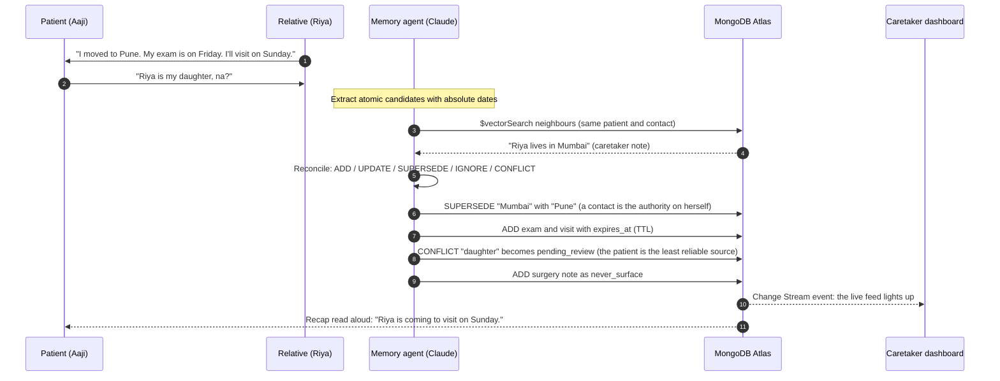
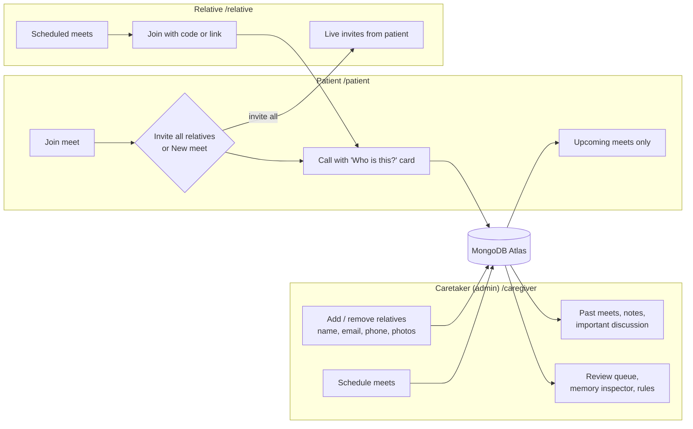
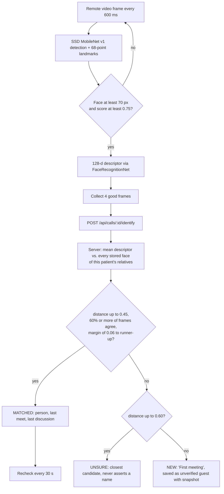
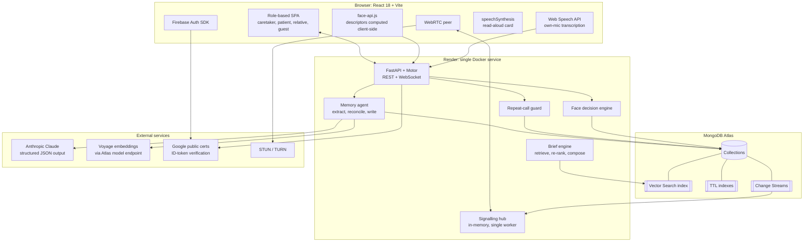

<div align="center">

# Pehchaan

### An agentic-memory video-calling companion for people living with Alzheimer's disease

**MongoDB Student Hackathon · SVNIT · Track 1: Agentic Memory**


-46E3B7)

*Pehchaan* (पहचान) means **recognition**. The product recognises the person on the screen, and it remembers what the two of them said last time.

</div>

---

## 1. Agentic Memory: the core of the system

Pehchaan is built on one thesis: **for a patient with Alzheimer's disease, an assistant is only useful if its memory is
persistent, structured, governed and self-correcting.** A flat chat history or a vector dump of raw transcripts cannot
satisfy those four properties. Pehchaan therefore treats memory as a **first-class, autonomously curated MongoDB
data model** rather than a log.

After every call an **LLM agent** reads the speaker-tagged transcript and decides, *per fact*, whether to
**ADD**, **UPDATE**, **SUPERSEDE**, **IGNORE** or flag a **CONFLICT**. That decision is then constrained by a
deterministic, code-enforced **trust-and-provenance policy**. The next call begins with a brief that is *retrieved,
re-ranked and policy-filtered* from that memory. The memory also **changes actions, not only text**: it can refuse to
place a call.

| Property of the memory | Mechanism | MongoDB primitive |
|---|---|---|
| **Persistent** | Atomic, dated facts with provenance (`source.call_id`, `source.quote`, `speaker`) | Document model, `memories` collection |
| **Semantically retrievable** | 1024-dimensional embeddings, pre-filtered by patient, contact, status and visibility | **Atlas Vector Search** (`$vectorSearch`, `memory_vec`) |
| **Self-correcting** | Supersede chains (`supersedes` / `superseded_by`), versioning, conflict links | Document references and atomic updates |
| **Governed** | Trust hierarchy, `pending_review` queue, `visibility` classes, hard-delete "forget" | Compound indexes, cascade deletes |
| **Self-expiring** | Events and plans expire automatically after the event date | **TTL indexes** (`expires_at`, `expireAfterSeconds: 0`) |
| **Observable in real time** | Caretaker edits reach the patient's screen mid-call | **Change Streams** with pre-images |
| **Auditable** | Append-only log of ids and actions (never content), so forgetting really forgets | `memory_events` collection |
| **Analysable** | Calls per day and hour, recurring confusions, memory bank composition | **Aggregation framework** (`$facet`, `$lookup`, `$dateTrunc`) |

### What a single call does to the memory



The first call shows only the caretaker's basics. After the agent runs, the *same* relative's next brief says *lives in
Pune* and suggests *"How did your physics exam go?"*. That loop is what the system exists to demonstrate.

---

## 2. MongoDB is the system of record, the vector store, the event bus and the analytics engine

Every non-trivial requirement of the product maps to a native MongoDB capability. There is no second database, no
separate vector store and no message broker.

| MongoDB capability | Where it is used | Why it matters here |
|---|---|---|
| **Atlas Vector Search** (`$vectorSearch`) | `memory_vec` index over `memories.embedding` (1024-d cosine). Filter fields: `owner_id`, `contact_id`, `type`, `status`, `visibility`, `embedding_model`, `created_at`. Used by the write path (neighbours of each candidate fact) and the read path (brief retrieval). | **Pre-filtered ANN retrieval.** A patient's search can never cross into another patient's data, and `superseded`, `caregiver_only` and `never_surface` rows are excluded *inside* the index query rather than after the fact. |
| **Model-tagged vectors** | Every vector stores `embedding_model`; searches compare only like with like; a background job re-embeds locally embedded rows with Voyage. | Prevents mixing vector spaces when the embedding provider is rate-limited or swapped. |
| **TTL indexes** | `memories.expires_at` (event date plus N days), `transcript_chunks.created_at` (30 d), `invites` (7 d), `pairing_codes` (15 min), `auth_events` (90 d), `embedding_cache` (30 d). | Data minimisation is enforced by the database itself. Transcripts, one-time codes and stale events disappear without application cron jobs. |
| **Change Streams** (`fullDocumentBeforeChange`) | Watchers on `memories` and `calls`, relayed over WebSocket. | A caretaker's edit appears on the patient's "Who is this?" card **mid-call**. TTL deletions still show *what* expired, because of pre-images. |
| **Aggregation framework** | `app/stats.py`. One `$facet` over `calls`: per-day and per-hour counts (`$dateTrunc` / `$hour` in IST), who talks to whom (`$lookup` into `contacts`), period-over-period totals. One `$facet` over `memories`: bank by type, upcoming events, **recurring confusions** (the same mistaken belief grouped and counted). Activity from `memory_events` joined to `memories`. | Clinically relevant insight, such as sundowning clusters of blocked calls or one mistaken belief recurring three times, is computed server-side inside the database. |
| **Compound, sparse and unique indexes** | `(patient_id, scheduled_at)`, `(patient_id, status)`, `calls.code` (unique, sparse), `contacts.email` (sparse), `users.login_email` (sparse), `memberships (patient_id, user_id)` (unique). | Join-by-code, role resolution by verified email and per-patient scoping are all index-backed. |
| **Flexible document model** | `contacts.faces[]` (128-d descriptors and thumbnails embedded in the person), `calls.agent.actions[]`, `briefs.items[]` with per-candidate score breakdowns. | Nested, evolving structures live with their parent. No joins on the hot path. |
| **Atomic updates and unique constraints** | Seat locking, code generation retried on `DuplicateKeyError`. | Correctness under concurrent joins without distributed locks. |
| **Atlas Local and Atlas** | `docker-compose.yml` (`mongodb-atlas-local`) for development, Atlas M0 for production. | An identical feature set from laptop to deployment. |

### Collections

| Collection | Purpose |
|---|---|
| `memories` | The agentic memory: typed, versioned, vector-indexed, TTL-governed. |
| `memory_events` | Append-only audit trail of agent decisions (ids and actions only). |
| `contacts` | Relatives and guests: name, email, phone, relation, **face gallery**, approval status. |
| `meets` | Scheduled meets created by the caretaker (`scheduled_at`, invited relatives, status). |
| `calls` | Every meet or attempted call: code, join token, participant, summary, recap, caretaker note, guard result. |
| `transcript_chunks` | Speaker-tagged transcript, **auto-deleted after 30 days**. |
| `briefs` | Every generated pre-call brief with each candidate's score breakdown (inspectable). |
| `users`, `memberships`, `devices` | Identity linkage: owner / family / viewer roles per patient, paired tablets. |
| `pairing_codes`, `invites`, `auth_events` | One-time codes and the access log, all TTL-governed. |
| `embedding_cache` | Voyage results keyed by text hash, so identical text is never embedded twice. |

---

## 3. Product: three roles, one shared memory



| Role | Lands on | Capabilities |
|---|---|---|
| **Caretaker** | `/caregiver` | Enrols and removes relatives (name, email, phone, relation, **face photos**). Schedules meets. Reads every past meet with participants, notes and *important discussion*. Approves unverified guests. Edits rules and memories. Pairs the patient's tablet or sets the patient's Google email. |
| **Patient** | `/patient` | Sees **only** upcoming meets and one large **Join meet** button, then chooses **Invite all relatives** or **New meet**. Signs in with Google (email set by the caretaker) *or* a tablet pairing code, and never types a password. |
| **Relative** | `/relative` | Sees live invites when the patient invites everyone, scheduled meets, past meets with summaries, and a join-by-code box. Recognised by a **verified** email the caretaker entered. |

Calls are strictly **1-to-1**. A second person who tries to join a full meet is rejected (WebSocket close code `4409`).

### The call screen

* **Top: the participant card.** Name, photograph, relation, *previous meet date*, *what was discussed last time* and the caretaker's note. It is rendered in large type **and read aloud**.
* **Bottom: the invite bar.** Six-character meeting code, **Share invite link** (native share sheet or WhatsApp), **Copy link** and **Invite all relatives**.
* A guest who is not signed in may join by code or link after entering a display name and ticking a consent box.

---

## 4. Face recognition: the identity layer

The participant card is only trustworthy if the *identification* is. Pehchaan matches the live face against the
caretaker-enrolled gallery with a decision policy designed to **prefer abstention over a wrong name**.



| Control | Value | Purpose |
|---|---|---|
| Match threshold | `0.45` (`FACE_MATCH_THRESHOLD`) | Maximum Euclidean distance for a positive identification |
| Unsure band | `0.45` to `0.60` | Reported as *unsure*, never as a name |
| Runner-up margin | `0.06` | Rejects ambiguous matches between two similar relatives |
| Frame agreement | at least 60 % of 4 frames | Defeats single-frame false positives |
| Enrolment lookalike guard | below `0.40` to another relative | Refuses a photo that would make two people indistinguishable (the caretaker may override) |
| Enrolment quality gate | exactly one face, at least 70 px, score at least 0.75, spread check | Rejects blurry, tiny or multi-face photos |
| Privacy | Descriptors only (128 floats) plus a small JPEG thumbnail | No raw video is ever stored |

**Measured accuracy** (six sample photographs; same-person stressed frames against different people):

| Threshold | Strangers wrongly named (family of 8) | (gallery of 19) | Genuine matches retained |
|---|---|---|---|
| 0.50 | 7.2 % | 19.3 % | 100 % |
| **0.45 (default)** | **1.8 %** | **6.5 %** | **100 %** |
| 0.42 | 0 % | 0 % | 100 % |

Real webcams yield larger distances than re-encodings of the same photograph, so enrol 3 to 5 photographs per relative
under different lighting. The caretaker's **Test a face** panel runs the matcher against their own webcam.

---

## 5. System architecture



### Write path: `app/agent/pipeline.py`

1. **Extract.** Claude reads the speaker-tagged transcript and returns a summary, a patient-facing recap and *atomic*
   candidate memories with absolute dates.
2. **Neighbour retrieval.** Each candidate is embedded and searched with `$vectorSearch` over the same patient and
   contact. Same-type facts and relationships are always included.
3. **Reconcile.** Claude chooses `ADD / UPDATE / SUPERSEDE / IGNORE / CONFLICT` for the whole batch in one call.
4. **Trust guard, enforced in code** (`may_override`). Trust: caretaker `1.0`, contact about themselves `0.85`,
   contact about others `0.7`, patient `0.4`. *In this domain the user is the least reliable narrator.* Trust is
   **subject-aware**: Riya is the authority on her own life, so "I moved to Pune" supersedes the caretaker's older
   "lives in Mumbai". Patient claims never overwrite anything, and only the caretaker may alter relationships. Anything
   blocked becomes a `pending_review` CONFLICT.
5. **Lifecycle.** Events and plans receive `expires_at`. Sensitive items become `never_surface`. Patient claims route to
   `caregiver_only` and `pending_review`.
6. **Audit.** Every action is appended to `memory_events` (**ids and actions only**, so a hard "forget" is a true erase).

### Read path: `app/agent/brief.py`

Candidates come from deterministic core facts, **open loops** (events or plans within ±3 days), `$vectorSearch`
(filtered by owner, contact, `status: active` and `visibility: patient`) and the last two call summaries. They are then
re-ranked:

```
final   = 0.5·similarity + 0.2·recency + 0.15·importance + 0.15·trust      (+0.3 open-loop boost)
recency = exp(−days / 14)
```

The relationship memory is always shown. `never_surface` memories are passed to Claude only as **negative guardrails**
and are never displayed. Every brief persists each candidate's score breakdown, so the **Memory Inspector** can explain
*why* any item appeared.

### Memory changes actions: `app/agent/guard.py`

Caretaker-authored **constraint memories** carry a structured `rule` (`quiet_hours`, `max_calls_per_day`,
`min_gap_minutes`). Quiet hours and a daily cap are **hard blocks**. A minimum gap is a **soft reminder** with a
*Call anyway* button ("You spoke to Riya at 11:05. Riya will visit Aaji on Sunday."). Blocked attempts are stored, which
is what surfaces sundowning patterns in the insights.

### Real-time communication

* **WebRTC** 1-to-1 media, signalled over a WebSocket whose **authentication travels in the first frame, never in the URL**.
* ICE servers are fetched from `/api/ice` (STUN, plus an optional TURN relay through environment variables).
* One seat per role per call, enforced with a per-tab session id. A third party receives close code `4409`.
* Each browser transcribes **only its own microphone**. Chunks are tagged by speaker and posted to the call.

### Authentication and authorisation

**Firebase proves *who*. MongoDB decides *what*.** The backend verifies Firebase ID tokens using Google's public
certificates (only the project id is required, with no service-account key). Principal resolution order: anonymous,
paired device, patient, caretaker membership, *verified-email* match to a patient's `login_email`, *verified-email*
match to a relative's `contacts.email`, otherwise a new caretaker. Every route re-checks the caller's role for the
specific patient. Join links carry an unguessable token, and code lookup is IP rate-limited.

---

## 6. Technology stack

| Layer | Technology | Role in Pehchaan |
|---|---|---|
| **Database** | **MongoDB Atlas** (Vector Search, Change Streams, TTL, Aggregation), `mongodb-atlas-local` | Memory store, vector index, event bus, analytics, identity linkage |
| **Backend** | Python 3.12, **FastAPI**, Uvicorn, **Motor** (async driver), Pydantic v2 | REST and WebSocket API, async I/O, validation |
| **LLM** | **Anthropic Claude** (`claude-opus-5-5`), structured JSON output, `fallbacks: "default"` | Fact extraction, reconciliation, brief and recap writing |
| **Embeddings** | **Voyage** `voyage-3.5` (1024-d) via the MongoDB model endpoint, local hashed fallback | Semantic retrieval, cached in `embedding_cache` |
| **Frontend** | **React 18**, React Router 6, **Vite 5** | Role-based SPA, lazy-loaded face models |
| **Face recognition** | **`@vladmandic/face-api`** (SSD MobileNet v1, 68-point landmarks, FaceRecognitionNet) | In-browser 128-d descriptors, server-side decision policy |
| **Video** | **WebRTC**, WebSocket signalling, STUN/TURN | Peer-to-peer 1:1 video |
| **Speech** | Web Speech API (STT), `speechSynthesis` (TTS) | Live transcription, read-aloud participant card |
| **Auth** | **Firebase Authentication** (Google, email/password with verification, anonymous for tablets) | Identity. Authorisation lives in MongoDB. |
| **Deployment** | **Docker** (multi-stage: Node 20 build, then Python 3.12 slim), **Render** blueprint | One service serving the API and the SPA |
| **Tooling** | Headless smoke test, Docker Compose | Reproducible verification |

### Graceful degradation

Every external dependency has a fallback, and the dashboard shows which mode is active.

| Piece | Normal | Fallback |
|---|---|---|
| Memory agent and brief writer | Claude, structured JSON | Rule-based extractor and template brief (`agent/offline.py`) |
| Embeddings | Voyage `voyage-3.5`, 1024-d | Local hashed embedding of the same width, re-embedded later |
| Retrieval | Atlas `$vectorSearch` with pre-filters | Exact in-app cosine scan |
| Live updates | MongoDB Change Streams | Events emitted from application code |
| Speech-to-text | Web Speech API | "Type instead" box on both sides |
| Authentication | Firebase | **Dev auth mode** (local, no password) when `FIREBASE_PROJECT_ID` is blank |

---

## 7. Use cases

| # | Scenario | What happens |
|---|---|---|
| 1 | **Disorientation on a call.** Aaji sees an unfamiliar face. | The face is matched. The card names the person, relation and last conversation, and reads it aloud. |
| 2 | **A relative changes their life.** Riya moves from Mumbai to Pune. | The agent supersedes the old fact. The next brief is correct and the stale fact is retained only as history. |
| 3 | **The patient misremembers.** Aaji calls Riya her daughter. | The claim is trust-weighted at `0.4`, never overwrites the caretaker's record, and is queued as a conflict. Repeated confusions are counted on the dashboard. |
| 4 | **A secret must stay a secret.** "Don't tell Aaji about Papa's surgery." | Stored as `never_surface`. Visible to the caretaker, passed to the LLM as a guardrail, never shown to the patient. |
| 5 | **Repeated calling and sundowning.** Aaji calls the same person eleven times in an evening. | The guard enforces caretaker rules, reassures with the last recap, and logs each blocked attempt for insight. |
| 6 | **A stranger joins.** | "First meeting". The face is stored as an unverified guest, and the caretaker approves or deletes it. Protects against scams. |
| 7 | **An upcoming event.** The exam on Friday. | The open-loop boost makes the next brief say "ask about the exam", and the TTL index removes the event afterwards. |
| 8 | **Caretaker oversight.** | Past meets with participants, notes and *important* flags, the review queue, and a per-memory score inspector. |
| 9 | **Privacy.** | Off-the-record mode, a consent banner, 30-day transcript TTL and hard-delete forgetting. Audio and video are never stored. |
| 10 | **Whole-family invite.** | The patient taps **Invite all relatives**. The call appears on every relative's dashboard, and the first to join takes the call. |

---

## 8. Repository layout

```
.
├── Dockerfile · .dockerignore · render.yaml      single-service deployment
├── docker-compose.yml                            local MongoDB with Atlas features
├── docs/
│   ├── DESIGN.md                                 full product and design specification
│   └── roles-and-deploy.md                       roles, face matching, Render guide
├── backend/
│   ├── requirements.txt · .env.example
│   ├── scripts/smoke.py                          headless end-to-end test of the memory loop
│   └── app/
│       ├── main.py             REST + WebSocket API; SPA serving with runtime config injection
│       ├── auth.py             Firebase ID-token verification, principal resolution, authorisation
│       ├── routes_auth.py      session, care circles, invites, device pairing, access log
│       ├── routes_meets.py     scheduling, patient home, relative home
│       ├── routes_faces.py     gallery, identify, guests, approval
│       ├── faces.py            face decision policy (thresholds, margin, agreement, confidence)
│       ├── db.py               collections; TTL, compound, sparse and vector indexes
│       ├── memory_store.py     memory documents, lifecycle, audit log, vector search
│       ├── embeddings.py       Voyage / local embeddings with cache and model tagging
│       ├── llm.py              Claude structured-output wrapper with fallbacks
│       ├── realtime.py         signalling relay, transcript fan-out, change-stream watchers
│       ├── stats.py            aggregation pipelines for caretaker insights
│       ├── seed.py             six weeks of demo history written through the real memory code
│       └── agent/              pipeline (write) · brief (read) · guard · prompts · offline
└── frontend/
    ├── public/models/          face-api weights (~13 MB, lazy-loaded)
    └── src/
        ├── lib/                identity, rtc, face, useFaceIdentify, speech, tts, api
        ├── components/         ParticipantCard, PhotoPicker, FaceTest, charts
        └── pages/              Login · PatientGate · PatientHome · RelativeHome · CallPage · JoinPage
                                caregiver/ Overview · Relatives · Meets · Calls · ReviewQueue · Inspector
                                           Briefs · Rules · Family · Onboarding
```

---

## 9. Getting started

**Prerequisites:** Python 3.11+, Node 18+, Chrome, and either Docker or a MongoDB Atlas cluster.

```bash
docker compose up -d                      # MongoDB with Vector Search, Change Streams, TTL
cp backend/.env.example backend/.env      # every key is optional (see Graceful degradation)
cd backend && python -m venv .venv && .venv/Scripts/pip install -r requirements.txt   # macOS/Linux: .venv/bin/pip
.venv/Scripts/python -m uvicorn app.main:app --reload --port 8000
```

```bash
cd frontend && npm install && npm run dev        # http://localhost:5173
```

Sign in at `/login`, choose **Explore the demo family**, and use **Reset demo** to regenerate the seeded history.
A detailed walkthrough is in [setup.md](setup.md).

### Environment

| Variable | Purpose |
|---|---|
| `MONGODB_URI`, `MONGODB_DB` | Atlas or local connection |
| `ANTHROPIC_API_KEY` | Memory agent (optional; rule-based fallback) |
| `VOYAGE_API_KEY`, `VOYAGE_BASE_URL` | Embeddings. Use `https://ai.mongodb.com/v1` for Atlas-issued keys |
| `FIREBASE_PROJECT_ID` | Enables real Firebase token verification (blank means dev auth) |
| `FIREBASE_WEB_API_KEY`, `FIREBASE_APP_ID` | Injected into the served page at runtime |
| `PUBLIC_BASE_URL` | Host used in invite links |
| `FACE_MATCH_THRESHOLD` | Default `0.45` |
| `TURN_URLS`, `TURN_USERNAME`, `TURN_CREDENTIAL` | Optional TURN relay |
| `TIMEZONE` | Default `Asia/Kolkata` |

**Never commit `.env` files, a Firebase service-account JSON, the Atlas password or API keys.** They are git-ignored.

### Verify

```bash
cd backend && .venv/Scripts/python scripts/smoke.py
```

With the backend in dev auth mode, this signs in, pairs a test tablet, enrols a synthetic face, plays a full meet
through the API and asserts each beat: face-based identification, supersede, conflict, TTL fields, `never_surface`,
the repeat-call guard, the later brief and the score breakdowns.

### Deploy (Render, one service)

The `Dockerfile` builds the SPA and serves it from FastAPI, so there is one origin and no CORS. In Render choose
**New → Blueprint** on this repository (`render.yaml`), set the environment variables above, allow `0.0.0.0/0` in Atlas
Network Access, and add the Render hostname to Firebase **Authorized domains**. Run exactly **one** Uvicorn worker, since
the signalling hub is in-process. Full instructions: [docs/roles-and-deploy.md](docs/roles-and-deploy.md).

---

## 10. Five-minute demonstration

1. **First meet.** Aaji joins. Riya (by code) says *"I moved to Pune. My physics exam is Friday. I'll visit on Sunday."* Aaji says *"Riya is my daughter, na?"* Riya adds *"Don't tell Aaji about Papa's surgery."*
2. **Agent runs.** The dashboard feed lights up through Change Streams. *Pune* supersedes *Mumbai*, the exam and visit are added with `expires_at`, *daughter* lands in the review queue, and the surgery note is `never_surface`. Aaji hears the recap.
3. **Guard.** Start another meet immediately: *"You spoke to Riya at 10:15… Do you still want to call?"*
4. **Time travel.** Advance the demo clock past the exam. The next brief says *lives in Pune* and suggests *"How did your physics exam go?"*
5. **Inspect.** Open the memory in the Inspector: source quote, score bars, supersede chain, audit log.
6. **Stranger.** Join from an unenrolled face. The card says *"First meeting"* and a guest appears for approval.
7. **Expiry.** Add an expiring memory on the Live tab. The TTL monitor deletes it within about 1 to 2 minutes.

---

## 11. Ethics, privacy and safety

* **Consent first.** Every participant sees a consent banner. Receivers can go **off the record**, and nothing said then is stored.
* **Data minimisation.** Audio and video are never stored. Transcripts expire after 30 days by TTL. Faces are stored as numeric descriptors plus a small thumbnail.
* **The patient is not ground truth.** Patient statements are trust-weighted at `0.4` and can never overwrite the caretaker's record.
* **Abstention over error.** A face below the confidence policy is reported as *unsure* or *new*. The system never asserts a name it cannot justify.
* **Caretaker control.** Caretakers decide what the patient may see, unknown people require approval, and forgetting is a hard delete.
* **Least privilege.** Every route checks the caller's role per patient. WebSocket credentials never appear in URLs or logs. Join tokens are unguessable and code lookup is rate-limited.

Pehchaan is a **communication aid, not a medical device**.

---

<div align="center">

Built for the **MongoDB Student Hackathon, SVNIT** · Track 1: **Agentic Memory**

</div>
